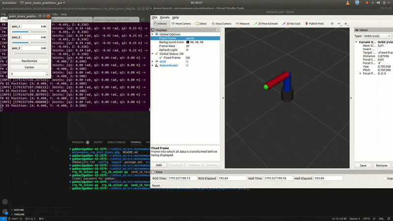
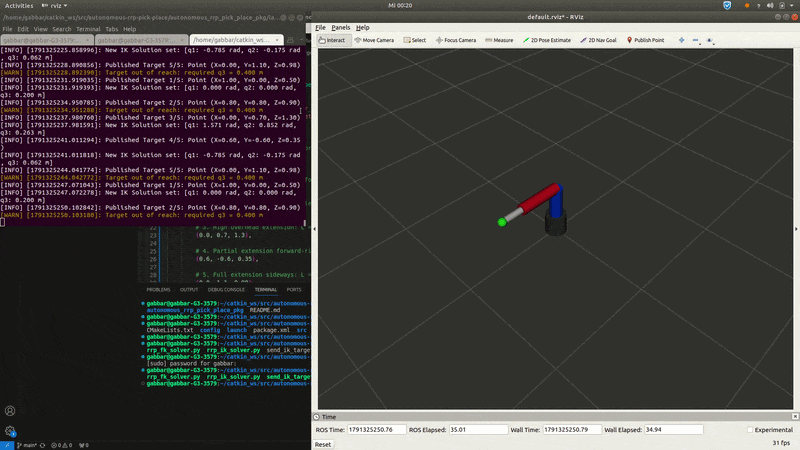

# autonomous-rrp-pick-place
 An end-to-end ROS Melodic autonomous manipulation pipeline integrating  a custom 3-DOF RRP manipulator (shown in the images below) along with the corresponding FK/IK solvers.

  


## *Foward Kinematics*
Forward Kinematics is the process used to calculate a robot's end-effector position and orientation from known joint parameters like angles or displacements. Joint variables, denoted by $\theta$ for a revolute joint and $d$ for prismatic joint, represent the relative displacement between adjacent links. The process involves the use of **Denavit-Hartenberg Parameters** or the transformation matrices, where the individual transformation matrices from the base frame to the tool tip are multiplied sequentially. 

## *Inverse Kinematics*
Inverse Kinematics, as the name suggests, is just the opposite of forward kinematics which is used to calculate the joint parameters such as angles or actuator lengths needed to place a robot's end-effector at a desired target position and orientation. There can be multiple solutions in case of inverse kinematics (for ex.: elbow down or elbow up).


## *Launching Demo*
1. The Forward Kinematics demo can be launched using:
```bash
roslaunch autonomous_rrp_pick_place_pkg fk_demo.launch
```

2. The Inverse Kinematics demo can be launched using:
```bash
roslaunch autonomous_rrp_pick_place_pkg ik_demo.launch
```


## *Live Demos*


